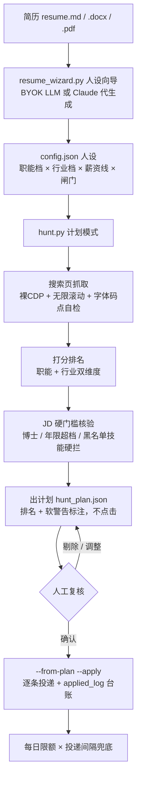

# boss-job-hunt · BOSS直聘本地求职助手

简历 → 人设配置 → 岗位搜索 → 匹配排名 → **人工确认** → 自动投递。
纯本地运行：引擎驱动**你本人**已登录的浏览器（Edge），不经过任何第三方服务器，不碰你的账号密码。

> ⚠️ **风险声明**：自动化操作第三方网站违反其服务条款，存在账号风控风险。
> 本工具默认保守限额（每日 ≤20、投递间隔 ≥8s、投递前强制人工复核计划）就是为了压这个风险，
> 请勿自行调高。只用于操作你本人的账号。

## 它长什么样（一次典型使用）

```
你：帮我搜一轮 售前 岗位，上海
引擎：搜索 253 条 → 黑名单拦 15 → 职能不符拦 64 → 打分核验 →
      出计划 15 条（表格：排名/分数/岗位/薪资/软警告）
你：第 3、11 条去掉，其余投
引擎：投出 13/13，全部 toast 确认 ✓
```

## 完整流程



## 三分钟上手

```bash
# 0) 依赖：Python 3.10+、Windows + Edge
pip install -r requirements.txt

# 1) 从简历生成人设配置（推荐在 Claude Code 里装下面的 skill，全程对话完成）
#    无 API key：--dry-run 打印规格，让 Claude 照规格生成
set LLM_API_KEY=sk-xxx        # DeepSeek / GLM / 任意 OpenAI 兼容端点
python resume_wizard.py --resume 我的简历.md --city 上海,杭州 --salary-min 15
#    人工过目生成的 config 文件后，改名/指定为 config.json

# 2) 出计划（只搜不打）
python hunt.py "售前工程师,解决方案经理" --city 上海

# 3) 复核 data/hunt_plan_*.json 后投递
python hunt.py --from-plan data/hunt_plan_XXXX.json --apply
```

配合 Claude Code 使用（推荐）：把 `skill/boss-job-hunt/` 整个目录复制到
`~/.claude/skills/`，然后直接说「帮我投简历」。

## 架构：为什么是「裸 CDP」

本项目用浏览器调试协议（CDP）的**最小子集**驱动 Edge：只发 `Runtime.evaluate`，
不发 `Page.enable` / `Target.setAutoAttach` 等任何 enable 命令。
实测 Playwright 的 `connect_over_cdp` 会触发 BOSS 的自动化识别（页面被弹回首页），
裸 CDP 不触发。这条边界是整个方案的地基——**不要用任何主流自动化框架替换它**。

```
job-hunt/
├── hunt.py            主流水线：搜索→打分→JD硬门槛核验→计划→投递（引擎与配置分离）
├── resume_wizard.py   简历→人设配置向导（BYOK LLM，零额外依赖）
├── fetch_jobs.py      搜索页抓取（无限滚动 + 薪资字体解码 + 码点自检）
├── fetch_jd.py        详情页 JD 抓取（自愈重连）
├── cdp_raw.py         裸 CDP 客户端（整个方案的根基）
├── start_edge.ps1     拉起带调试端口的 Edge
├── smoke_test.py      离线冒烟测试（改完先跑这个）
├── config.demo.json   异人设示例（测试/QA 方向）
├── examples/          示例简历 + 向导生成的人设示例
└── skill/boss-job-hunt/  Claude Code skill 壳
```

## 人设配置（引擎的灵魂）

打分 = 职能档 + 行业档 + AI 加分 + 领域加分 + 薪资档，全部来自配置：

| 键 | 作用 | 示例见 |
|----|------|--------|
| `role_tiers` | 职能打分档（关键词→分数→tag） | config.demo.json |
| `allowed_roles` | 放行的职能 tag 白名单 | |
| `industry` | 行业词表 high/mid/low（±30/±10） | |
| `domain_bonus` | 深耕领域加分词 | |
| `hard_skill_blacklist` | JD 出现即硬拦的技能（相邻岗招牌技能） | |
| `experience_max_years` | 经验上限，JD 超档硬拦 | |
| `degrees_reject` / `edu_warn_words` | 学历硬拦 / 软警告（⚠ 不拦，照投让对面 judge） | |
| `title_blacklist` | 标题黑名单（储能/GEO/语料这类零重叠热门词） | |
| `limits` | 每日上限/单轮上限/滚动轮数/投递间隔 | |

设计哲学（踩坑换来的）：
- **职能 + 行业双维度**——只看职能会让金融方向的"AI产品经理"拿高分；
- **软硬分级**——「统招/全日制」这类差一点的门槛软警告照投，经验超档/博士/黑名单技能硬拦；
- **title_blacklist 是零回复复盘的产物**——48 投零回复里 17 条是储能/具身/GEO 这类关键词撞车岗。

## 已知限制（如实说）

- **薪资字体混淆**：BOSS 用私用区码点混淆薪资数字（2023 年固定字体）。引擎内置码点
  自检 + 全量解析失败自动降级（跳过薪资过滤照常跑），但若换字体且码点区间不变，
  解码可能悄悄出错——计划复核时人工扫一眼薪资即可兜底。
- **反爬会演进**：本项目的应对是「像人」（真实浏览器、真实登录态、保守间隔），
  不是对抗升级。请勿在此基础上加注入/多开/代理池。
- 详情页导航带 `security_check` 参数且渲染慢，投递循环已内置 30s 轮询；
  仍偶发跳过的岗位下轮再投即可。

## Roadmap

- [ ] 本地 Web 控制台（FastAPI：计划勾选、投递统计、人设编辑）
- [ ] JD 语义匹配（LLM 对 top 岗位逐条复评）
- [ ] 招呼语按岗位定制（当前用用户在 APP 里设置的默认话术）

## License

MIT —— 但请带着上面的风险声明一起分发。
